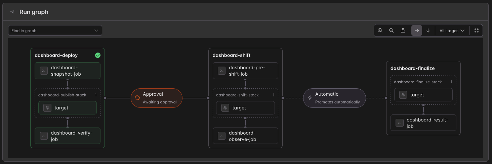
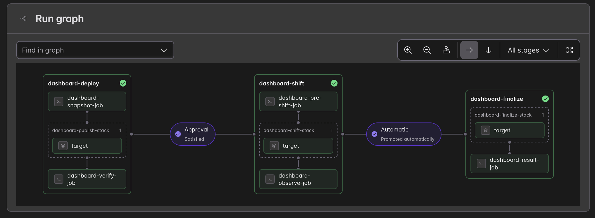

# AWSX Delivery demo

Deploy an Amazon ECS service with a canary strategy and test the new revision
before it receives production traffic. Pulumi Delivery runs the tests while an
ECS lifecycle hook holds the deployment, then verifies that the deployment completes.

Blog walkthrough: **link pending publication**.

The ECS service and task definition use the published AWSX v3.14.0 package.
The experimental Delivery hook and checkpoint are local components and are not
part of the AWSX library. The demo creates billable AWS resources.
Its load balancer is public. The test header selects a route, not an authenticated
endpoint. Do not expose sensitive test behavior without additional access controls.
Direct updates outside Delivery explicitly bypass the test checkpoint.

## Lambda Web Function canary

The Lambda demo uses [infra-web](infra-web/index.ts) for the function and its
endpoints, and [pipeline-web](pipeline-web/index.ts) for the Delivery pipeline.
The test endpoint sends requests to the candidate revision. The production
endpoint routes traffic according to the canary stage.

1. **Deploy** records the current production revision, publishes a candidate,
   and runs the [verification script](pipeline-web/scripts/probe.ts) against
   the test endpoint. The pipeline then waits for approval.

   

2. After approval, **Shift** checks the production revision, sends a share of
   traffic to the candidate, and runs the probe during the canary period.
3. **Finalize** sends all traffic to the candidate if the probe passes. If the
   probe fails or times out, Finalize restores the stable revision and reports
   the failure.

The completed run below shows a successful rollout.

The first deployment has no stable revision. It sends all production traffic to
the candidate before approval and skips the traffic split and canary period.
Run one release at a time per target. For recovery and configuration details, see
the [Lambda Web Function canary component](components/awsx-delivery/README.md#lambda-web-function-canary).

## Repository layout

- `identity/` defines the hook's identity and permissions.
- `infra/` defines the application, load balancer, and ECS service.
- `pipeline/` defines the Delivery pipeline and integration-test checkpoint.
- `infra-web/` and `pipeline-web/` demonstrate a Lambda Web Function canary with caller-defined verification and rollback. The demo endpoints are public.
- `shared/` holds deployment identifiers and checkpoint settings.
- [`components/awsx-delivery/`](components/awsx-delivery/README.md) contains the reusable preview components.

See [Contributing](CONTRIBUTING.md) for local setup and checks.
